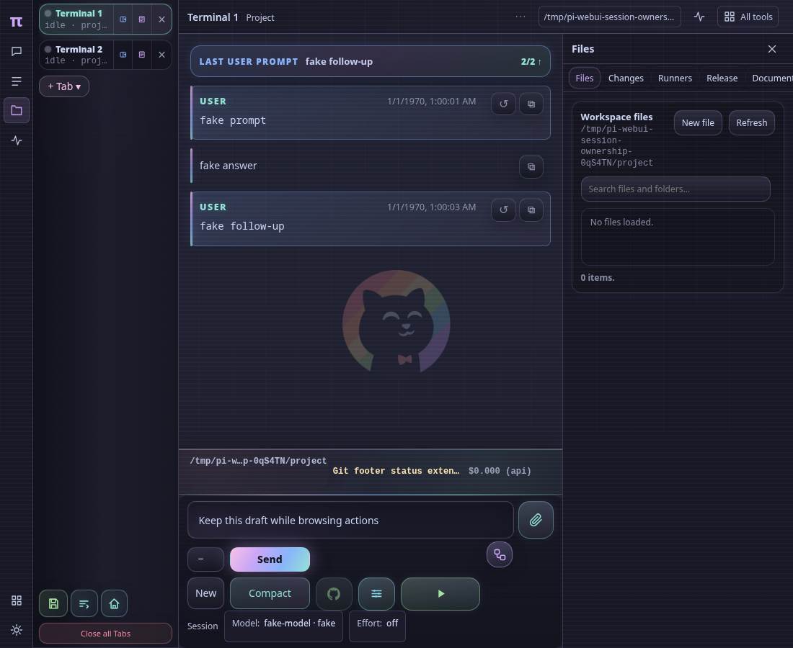
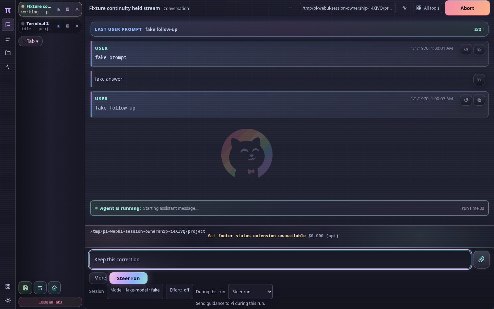
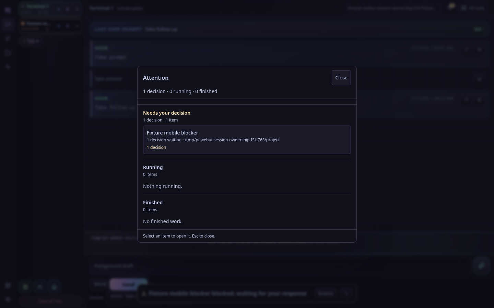
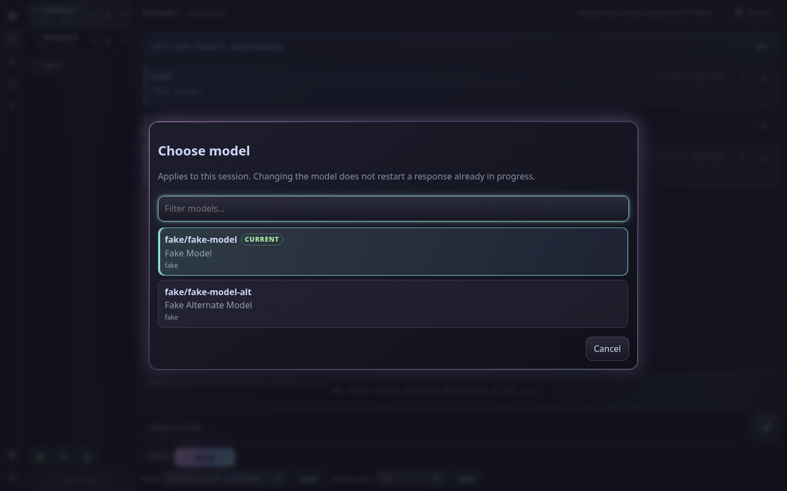
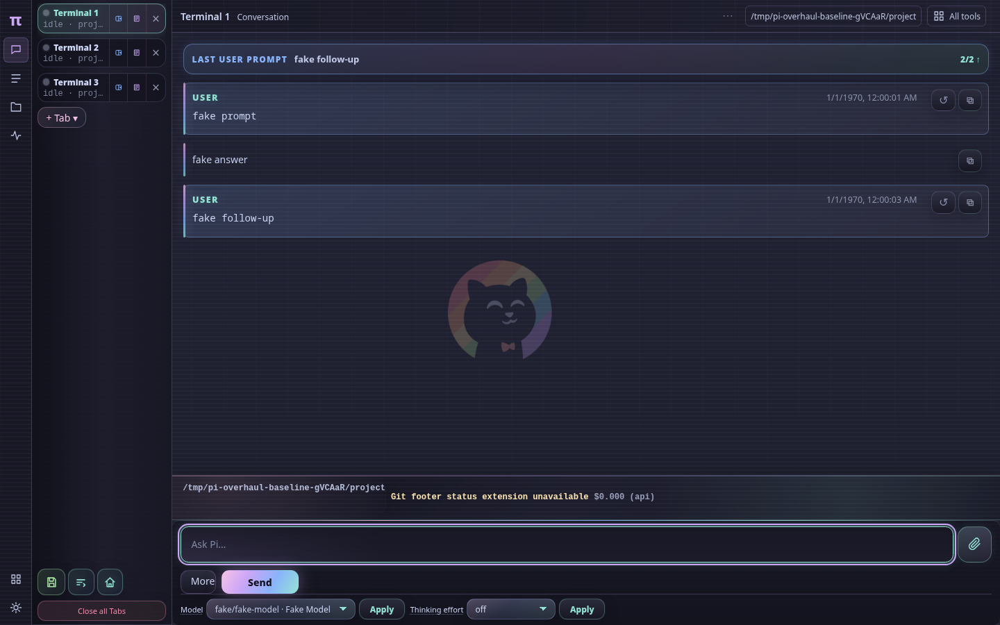
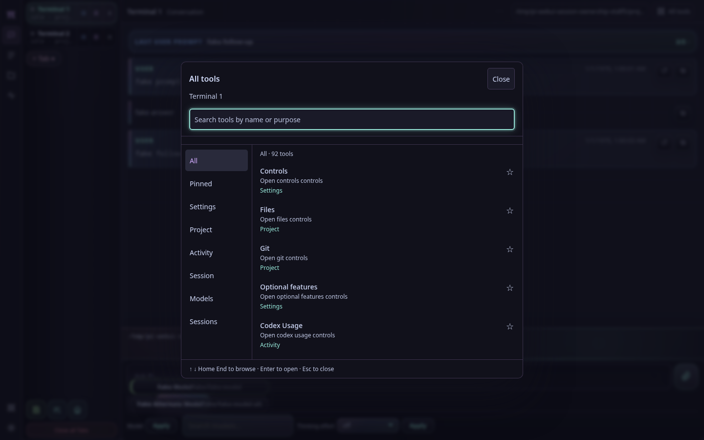
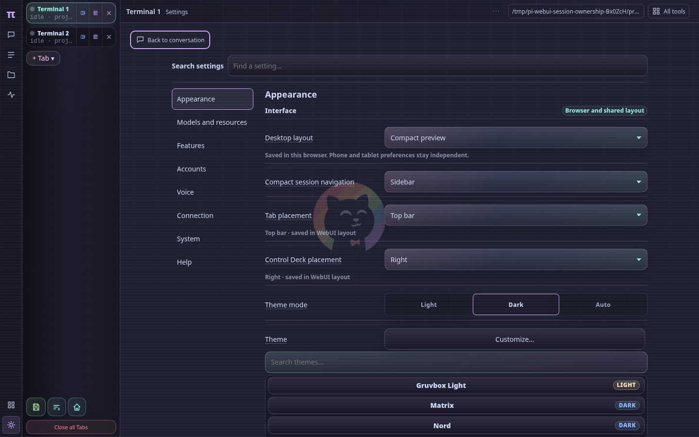
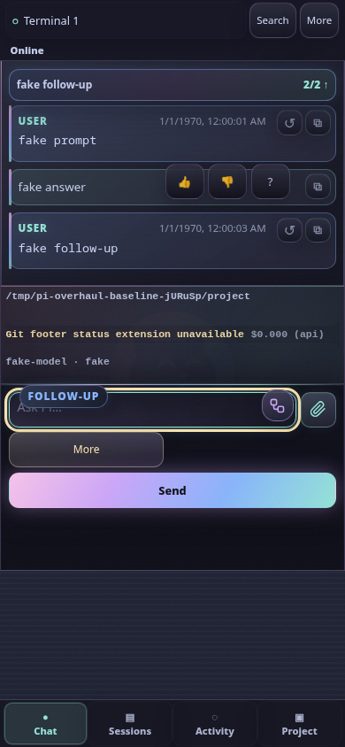
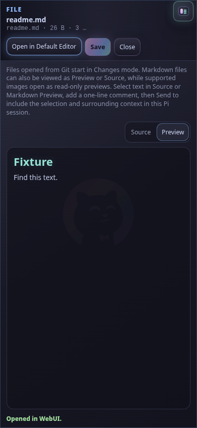
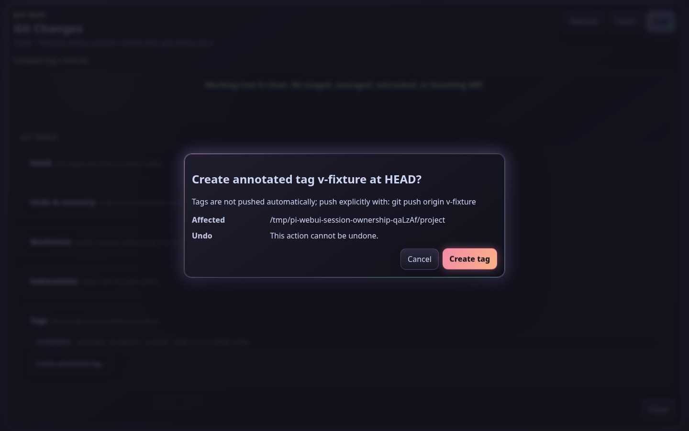

The WebUI had accumulated competing controls and configuration panels. This overhaul gives frequent work a compact home while preserving Pi’s themes, backgrounds, typography, and existing feature scopes.

Conversation, Project, Activity, and searchable Settings now have clear destinations. All tools provides categorized search and pins; contextual actions reveal less frequent features. Focused controllers own session, composer, feature, and view state. Backend services retain existing HTTP/SSE, supervisor, security, and persistence contracts.

Existing installations keep Classic unless you select **Controls → Interface → Desktop layout → Compact preview**. Proven fresh installations default to compact desktop. Browser preferences take precedence, and `?shell=classic` provides recovery without deleting saved arrangements.

The follow-up Terra live pass fixes off-screen new-tab choices, misleading feature summaries, phone file-action overlap, directory-picker cancellation and focus, repository-specific Git confirmation, and error notices covering mobile Retry. All tools now returns nested picker focus to its visible opener.

The interaction pass adds one visible composer submission action, effective session model/effort pickers, a decision/running/finished inbox, and six-item contextual menus backed by the same All tools catalog as Ctrl/Cmd+K. Model/effort failures stay inline, and captured session/dialog identities reject stale work.

The More disclosure now expands into its own action row without stretching More or Send. Nested menus are no longer clipped. This CSS repair passed 16 focused browser checks and 25 affected static files; the full suites above were not repeated for this repair.

### Validation

- Current package validation: all 251 Node/static/harness files pass. All 51 new interaction browser cases pass.
- Current complete Chromium run: 572/580 passed. Seven failures targeted the replaced model/effort controls; all seven pass after updating the tests while preserving their behavioral assertions. The unchanged Classic overlay test passed four subsequent runs, but its initial failure remains unexplained. Every case has passing evidence on the final production code; this is combined full-run and targeted-recheck evidence, not one uninterrupted green full run. No skips or automatic retries.
- Two fresh Sol/high reviewers reported no actionable interaction findings, independently passing 41 unit/adapter cases and 71 browser cases. The follow-up test-selector repairs were verified by the parent. No second interaction review round was needed.
- Earlier Terra polish validation passed 250 package files and 529 Chromium cases.
- The original overhaul passed 20 remote-companion checks and 16 frozen measurement checks. Those measurements were not recaptured during polish or the interaction pass; the frozen references are unchanged.
- Desktop secondary controls decrease 37.9% idle and 35.5% while streaming; phone/tablet counts do not increase. All original performance budgets passed with no lost final output in that measurement run.
- Sol/high implementation and reviews used at most two rounds per overhaul wave. The Terra/high polish pass also completed two review rounds; accepted fixes were rechecked. The final mobile-notice repair received parent verification and the complete suite, with no third review round.
- Inventory, required packaged assets, documentation links and whitespace checks pass. Internal evidence is excluded from the npm package.

Linux Chromium, including genuine 200% zoom, is verified. Physical mobile keyboards/IME, Windows/macOS execution, WebKit, microphones, and live installed-provider/companion combinations remain unmeasured.

See the [implementation record](https://github.com/Firstp1ck/pi-coding-agent-forge/blob/2fb0644032e2398e33dc9729e8dcbee3f4029dc0/pi-package-webui/docs/overhaul/implementation-record.md) for architecture, measurements, and verification boundaries.

The audits do not establish exhaustive coverage of every individual control/state. Live provider/companion installation, remote/PIN combinations, notification permissions/click behavior, real updates and publishing remain unverified.

### Screenshots

These captures show the implemented UI with disposable test sessions and the existing Pi theme.

Current interaction controls

**Desktop workspace before the interaction pass**

All tools and searchable Settings

Mobile conversation

Polish: mobile file actions and repository confirmation

Created with GPT-6 Astra and GPT-6.1 Sol in T3 Code through Codex. GPT-6.1 Sol workers implemented delegated changes and performed independent reviews.

The follow-up live audits, delegated fixes and independent reviews used GPT-6.1 Terra at high reasoning effort in T3 Code through Codex.

### Sidebar and control refinements

- Sessions are grouped into Inbox, Working, and collapsed-by-default Settled. Settle/Restore is explicit; new work or input requests bring a session back. The session sidebar supports dragging and keyboard resizing with a saved browser preference.
- Activity uses a grouped View picker instead of a horizontally scrolling topic strip. Scoped models is directly available beside Model.
- Settings has a bottom-left gear and searchable homes for Sampling, Codex speed, Summary Setup, runner configuration, Git-footer Visibility, and saved tool-output expansion. Existing scopes, confirmations, and session/project ownership remain intact.
- More/Send stay compact. Secondary actions occupy their own row, including minimized workflow controls. Short-window suggestions and nested menus retain reachable controls.
- The full model catalog groups by provider, then explicit release date newest first with alphabetical fallback for undated entries. Wrapped provider headings cannot cover keyboard-selected models; saved scoped-model order is unchanged.

Validation for this addition: all 254 package test files passed before the final CSS-only heading correction. The correction passed all eight model selection/hierarchy browser cases, 31 checks across 27 affected static files, inventory validation, and PWA181 offline/online recovery. The integrated run also passed 60 browser cases and 27 composer cases. These are affected-feature checks, not a new complete browser-suite or performance run. Final model review is pending; Settings, composer, Activity and sidebar findings are resolved.

Latest controls with disposable test data

